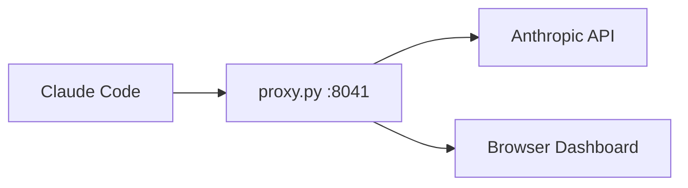

# Proxy Traffic Dashboard Spec

Live browser dashboard for `proxy.py` that displays the messages exchanged between Claude Code and the [Anthropic Messages API](https://docs.anthropic.com/en/api/messages) in real time, formatted for fast reading as traffic piles up.

## Goal

- **Readability at a glance:** Distinguish the user prompt, the model reply, a tool call, and a tool result immediately by color, badge, and layout.
- **Follow the conversation as it grows:** Show the newest messages at the top of the page, so the latest activity is visible without scrolling. Show only the new blocks added in each turn instead of repeating the full conversation history sent in every HTTP request.
- **Keep noise out of the way:** Collapse large system instructions, tool schemas, and long file outputs by default so the main flow stays easy to scan.
- **You control the detail:** Every card and every request group can be expanded or collapsed, one at a time or all at once.
- **Zero extra packages:** Serve the dashboard directly from `proxy.py` using only the Python 3 standard library.

## Architecture and Flow

1. Start `proxy.py --port 8041` in Terminal 1.
2. Start `ANTHROPIC_BASE_URL=http://localhost:8041 claude` in Terminal 2.
3. Open `http://localhost:8041` in the browser to view the live dashboard.
4. When Claude Code sends `POST /v1/messages`, `proxy.py` forwards the request to Anthropic, prints a short log in the terminal, and streams the decoded turn to the browser via Server-Sent Events (`GET /events`).

## Message Types and Visual Layout

Each message in the Anthropic `messages` list contains one or more content blocks. The dashboard renders four distinct card styles in a single centered column, with the newest messages at the top (see *Message Order: Newest First*). Every card can be expanded or collapsed (see *Expanding and Collapsing Cards*).

- **User Prompt (`role: "user"`, `type: "text"`):** Blue left border with a **USER** badge. Shown expanded by default so you can always see what triggered the turn. Injected `<system-reminder>` blocks are collapsed into a small gray pill.
- **Model Reply (`role: "assistant"`, `type: "text"` and `type: "thinking"`):** Green left border with a **MODEL** badge, model name, and response time. Shown expanded by default, with the final reply text rendered as Markdown; internal `thinking` blocks are collapsed into a single-line preview.
- **Tool Call (`role: "assistant"`, `type: "tool_use"`):** Orange left border with a **TOOL CALL** badge, the tool name (such as `Read` or `Bash`), and the main argument (such as `file_path` or `command`) shown inline in monospace. Collapsed by default; expanding the card shows the full JSON `input`.
- **Tool Result (`role: "user"`, `type: "tool_result"`):** Teal left border on success or red left border when `is_error` is `true`, with a **TOOL RESULT** badge and the matching `tool_use_id`. Long outputs (like file contents) show a 3-line preview with a line-count badge and expand on click.

## Handling Fast-Growing Conversations

- **System instructions drawer:** The top-level `system` prompt and `tools` definitions are sent on every request. The dashboard keeps them collapsed in a single top bar (**System & Tools**) and highlights changes only if they differ from the previous request.
- **Turn deduplication:** Every `POST /v1/messages` request re-sends all prior turns. The dashboard compares the incoming `messages` list to the previous request and shows only the newly added blocks, in a new `Request #N` group at the top of the stream.
- **Newest on top, the view stays put:** New messages appear at the top of the page. If you have scrolled down to read older cards, what you are reading does not move, and a floating **Jump to Latest** button appears (see *Message Order: Newest First*).
- **Quick filters:** A sticky top bar lets you toggle `System`, `Thinking`, and `Tool Details`, or filter cards by text.
- **Expand all / Collapse all:** Two buttons in the same top bar expand or collapse every card in the view (see *Expanding and Collapsing Cards*).
- **Clear button:** A **Clear** button in the same top bar wipes the view without losing track of the conversation (see *Clearing the View*).

## Message Order: Newest First

The stream is in reverse chronological order: the newer a message is, the higher it is on the page.

- **Top-level items:** Request groups, side-request rows, **New Conversation** markers and the **Cleared at** marker are each inserted at the top of the stream when they arrive.
- **Inside a request group:** The `Request #N` header stays at the top of its group. Below it, messages are ordered newest first:
  1. The model's response to that request. While the request is in flight, the `Waiting for Claude...` indicator takes this spot, and the response replaces it there.
  2. The new messages sent in that request, last message first.
- **Inside a message:** The content blocks of one message keep their original order. A model's text stays above the tool call it made in the same message, and several `tool_result` blocks in one user message stay in the order they were sent.
- **Late responses:** When requests overlap (for example a subagent running next to the main agent), a response always goes into its own request group, even if a newer group is already above it. The group is not moved. The new card flashes briefly so you notice it.
- **Markers point up:** A marker is inserted when its event happens, so it ends up directly below everything that came after it. The labels show this with an arrow:
  - `▲ New Conversation · #N` sits right below the first request group of that conversation.
  - `▲ Cleared at HH:MM:SS` sits at the bottom of the stream after a Clear, and new traffic stacks above it.
- **Tool result badges:** The chronological **TOOL RESULT** badge is placed where the result arrived. With newest-first order that is above its tool call card, so clicking the badge scrolls down to the paired card (see Decision 1).
- **Scrolling:**
  - When you are at the top of the page (within 80 px), new items appear in view and the page stays at the top.
  - When you have scrolled down, items inserted above must not push what you are reading down the page. The dashboard keeps the card at the top of the viewport in place (scroll anchoring).
  - In that case a floating **Jump to Latest ↑ (N new)** button appears near the top of the window and counts the new items. Clicking it scrolls smoothly to the top and resets the count. Scrolling back to the top by hand also hides it.
  - The same anchoring applies when a card above the viewport is expanded or collapsed, or when a `Waiting for Claude...` indicator is replaced by its response.
- **Replay and refresh:** On page load the history is replayed in the order it happened, and each item is inserted the same way as live. The result is the same layout you would have seen watching live. After the replay, the page is scrolled to the top.
- **Browser-only change:** The order is decided in the browser. `proxy.py` keeps sending the same `GET /events` events in the same order, so the server and the event format do not change.

## Expanding and Collapsing Cards

Every card has two states, **expanded** and **collapsed**, and you can switch between them at any time.

- **Toggle control:** Each card header starts with a chevron (`▸` when collapsed, `▾` when expanded). Clicking anywhere on the header toggles the card, except on links, chips or while selecting text. The header can be focused with the keyboard. `Enter` or `Space` toggles it, and it reports its state with `aria-expanded`.
- **What each state shows:**

  | Card | Collapsed | Expanded | Default |
  |---|---|---|---|
  | **USER** | Header, the first line of the prompt (without `<system-reminder>` text) and a character count | The full prompt. `<system-reminder>` blocks stay gray pills. | Expanded |
  | **MODEL** | Header with model, time and tokens, and the first line of the reply | The full reply as Markdown. `thinking` blocks stay one-line previews that open on their own. | Expanded |
  | **TOOL CALL** | Header with tool name, main argument and result status, and the nested result's 3-line preview (or `awaiting result…`) | The full JSON `input` and the nested result's full output | Collapsed |
  | **TOOL RESULT** (standalone) | Header, a 3-line preview and the line count | The full output | Collapsed |
  | **API ERROR** | Header and the first line of the error | The full error body | Expanded |

  The defaults match what the dashboard shows today, so nothing changes until you click. If a card has nothing more to show when expanded (for example a one-line tool result), its chevron is dimmed and clicking does nothing.
- **Request groups:** Clicking the `Request #N` header collapses the whole group into that one line, and clicking again expands it. The collapsed line keeps its current text (`+N new messages`, time, model) and adds a short count of what is inside, such as `MODEL · 2 TOOL CALLS`. Clicking a `system changed` or `tools changed` chip still opens the **System & Tools** drawer and does not toggle the group. Groups start expanded.
- **Side requests:** Side-request rows keep their current behavior: a one-line row that opens on click.
- **Expand all / Collapse all:** These two buttons in the sticky top bar set every card and every request group currently in the view to expanded or collapsed. Items that arrive later start in their default state. `thinking` previews and `<system-reminder>` pills are not affected. They keep their own toggles and the **Thinking** and **System** filters.
- **Tool Details filter:** The **Tool Details** checkbox now sets the state of tool cards. When it is on, every TOOL CALL and TOOL RESULT card in the view is expanded, and new ones arrive expanded. Turning it off collapses them again. Either way, you can still toggle a single tool card.
- **How it works with other features:**
  - The text filter searches the full content of collapsed cards too. Matching cards keep their current state.
  - Clicking a **TOOL RESULT** badge expands its paired tool call card, and its request group if that is collapsed, then scrolls to it.
  - A collapsed tool call card stays collapsed when its result arrives. Only the result status in its header and the preview change.
- **State is per tab:** The expanded or collapsed state lives only in the open tab. It is not sent to `proxy.py` and not shared between tabs. A refresh rebuilds the view with the default states.

## Clearing the View

A **Clear** button in the sticky top bar lets you start reading fresh in the middle of a long session, without restarting `proxy.py` or Claude Code.

- **Action:** Clicking **Clear** sends `POST /clear` to `proxy.py`. There is no confirmation dialog, because clearing never affects the agent or the API traffic.
- **Local route:** `POST /clear` is handled by `proxy.py` itself and is never forwarded upstream. It answers `204 No Content` and prints one short line in the terminal (`--- dashboard cleared`).
- **What is cleared:**
  - The stored replay events, so a browser refresh after Clear shows only what came after it.
  - The view in every open dashboard tab. The proxy broadcasts a clear event over `GET /events`, and each tab empties its stream, its tool-call pairing map and its **Jump to Latest** counter. The stream then holds only a `▲ Cleared at HH:MM:SS` marker, which stays at the bottom as new traffic stacks above it.
- **What is kept in `proxy.py`:**
  - The message fingerprints/prefix snapshots used for turn deduplication. When the next `POST /v1/messages` arrives from the same Claude Code session, it still matches the current conversation. No **New Conversation** marker is added, and only the messages sent after the Clear are shown.
  - The request and conversation counters, so `Request #N` and conversation numbers keep counting up.
  - The latest `system` prompt and `tools` definitions. They are included in the clear event and in the replay, so the **System & Tools** drawer stays filled even though unchanged values are not re-sent with later requests.
- **Requests in flight:** If a request is still waiting for its response when Clear is clicked, its `Waiting for Claude...` indicator is kept (its already-shown messages are dropped). The reply renders as normal when it finishes, and it is part of the replay after Clear.
- **Tool results after Clear:** A `tool_result` whose `tool_use` card was cleared has no card to nest into. It falls back to a standalone **TOOL RESULT** card, as described in Decision 1.

## Steps to Build

1. Add `GET /` and `GET /events` routes to `proxy.py` without breaking existing `POST /v1/messages` forwarding.
2. Parse request and response JSON bodies in `proxy.py` to extract `system`, `tools`, and new `messages` blocks.
3. Build a single-file HTML/CSS/JS view with distinct card styles for **User Prompt**, **Model Reply**, **Tool Call**, and **Tool Result**.
4. Add a **Clear** button and a `POST /clear` route that empties the replay history and all open views, but keeps the deduplication snapshots, counters, and latest `system`/`tools`.
5. Show the stream newest first: insert top-level items at the top, order messages newest first inside each request group, keep the reading position with scroll anchoring, and replace **Jump to Live** with **Jump to Latest**. This is a browser-only change.
6. Add expand/collapse to every card and every request group, the **Expand all** and **Collapse all** buttons, and the new **Tool Details** behavior. This is also browser-only.
7. Test with Claude Code by asking it to read a small file. Check that system instructions, the `Read` tool call, and its file result appear live in the browser, that the newest card is at the top, and that cards and request groups expand and collapse. Without an API key, `tests/fake_upstream.py` and `tests/client.py` drive the same checks.

## Decisions

1. **Pairing tool calls with their results:** A `tool_result` (which arrives in the next HTTP request) is nested directly inside its matching `tool_use` card. A small chronological **TOOL RESULT** badge is still placed in the stream where the result arrived, which with newest-first order is above the tool call card. Clicking the badge expands the paired card and scrolls down to it. Results with no known `tool_use` are rendered as standalone cards.
2. **Live token streaming vs. completed turns:** The browser shows a live `Waiting for Claude...` indicator (with elapsed time) while a request is in flight, and renders the turn as soon as the response finishes. The indicator sits at the top of its request group, right under the `Request #N` header, and the response replaces it in the same spot. `proxy.py` reassembles the streamed SSE response into complete content blocks.
3. **Handling `<system-reminder>` blocks:** Collapsed behind a small expandable gray badge by default, both in user messages and in tool results.
4. **Saving traffic history:** Kept in memory only for the current run. On page load (`GET /events`) the full history is replayed first, in the newest-first layout, so browser refreshes keep the current session; restarting `proxy.py` starts fresh. The **Clear** button also empties this history, but keeps the deduplication state (see *Clearing the View*).
5. **Multiple conversations:** A single continuous stream. Whenever the incoming `messages` list does not extend a previously seen one (e.g. after `/clear`, a restart, or a new subagent), a `▲ New Conversation · #N` marker is inserted. With newest-first order it sits right below the first request group of that conversation. Tool-less side requests (titles, quota checks) are shown as compact one-line rows and do not start a new conversation.
6. **Newest first by message, not by card:** The order is reversed per message, not per content block, and a response always stays in its request group. A model's text stays next to the tool call it made, and a late response does not land in an unrelated group.
7. **Expand/collapse state stays in the browser:** The state is per tab and is not saved, so `proxy.py`, the event format and the replay do not change. A refresh returns all cards to their defaults.
