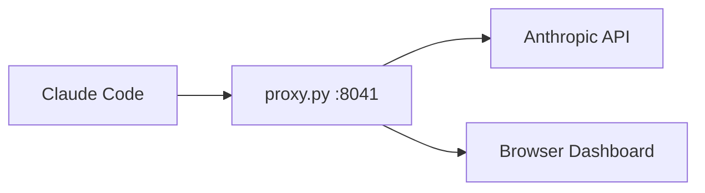

# Proxy Traffic Dashboard Spec

Live browser dashboard for `proxy.py` that displays the messages exchanged between Claude Code and the [Anthropic Messages API](https://docs.anthropic.com/en/api/messages) in real time, formatted for fast reading as traffic piles up.

## Goal

- **Readability at a glance:** Distinguish the user prompt, the model reply, a tool call, and a tool result immediately by color, badge, and layout.
- **Follow the conversation as it grows:** Show only the new blocks added in each turn instead of repeating the full conversation history sent in every HTTP request.
- **Keep noise out of the way:** Collapse large system instructions, tool schemas, and long file outputs by default so the main flow stays easy to scan.
- **Zero extra packages:** Serve the dashboard directly from `proxy.py` using only the Python 3 standard library.

## Architecture and Flow

1. Start `proxy.py --port 8041` in Terminal 1.
2. Start `ANTHROPIC_BASE_URL=http://localhost:8041 claude` in Terminal 2.
3. Open `http://localhost:8041` in the browser to view the live dashboard.
4. When Claude Code sends `POST /v1/messages`, `proxy.py` forwards the request to Anthropic, prints a short log in the terminal, and streams the decoded turn to the browser via Server-Sent Events (`GET /events`).

## Message Types and Visual Layout

Each message in the Anthropic `messages` list contains one or more content blocks. The dashboard renders four distinct card styles in a single centered column:

- **User Prompt (`role: "user"`, `type: "text"`):** Blue left border with a **USER** badge. Shown expanded by default so you can always see what triggered the turn. Injected `<system-reminder>` blocks are collapsed into a small gray pill.
- **Model Reply (`role: "assistant"`, `type: "text"` and `type: "thinking"`):** Green left border with a **MODEL** badge, model name, and response time. Final reply text is expanded and rendered as Markdown; internal `thinking` blocks are collapsed into a single-line preview.
- **Tool Call (`role: "assistant"`, `type: "tool_use"`):** Orange left border with a **TOOL CALL** badge, the tool name (such as `Read` or `Bash`), and the main argument (such as `file_path` or `command`) shown inline in monospace. Clicking the card expands the full JSON `input`.
- **Tool Result (`role: "user"`, `type: "tool_result"`):** Teal left border on success or red left border when `is_error` is `true`, with a **TOOL RESULT** badge and the matching `tool_use_id`. Long outputs (like file contents) show a 3-line preview with a line-count badge and expand on click.

## Handling Fast-Growing Conversations

- **System instructions drawer:** The top-level `system` prompt and `tools` definitions are sent on every request. The dashboard keeps them collapsed in a single top bar (**System & Tools**) and highlights changes only if they differ from the previous request.
- **Turn deduplication:** Every `POST /v1/messages` request re-sends all prior turns. The dashboard compares the incoming `messages` list to the previous request and appends only the newly added blocks under a lightweight `Request #N` divider.
- **Smart auto-scroll:** The page follows new messages automatically while you are at the bottom. Scrolling up to inspect an earlier tool call pauses auto-scroll and shows a floating **Jump to Live** button when new messages arrive.
- **Quick filters:** A sticky top bar lets you toggle `System`, `Thinking`, and `Tool Details`, or filter cards by text.
- **Clear button:** A **Clear** button in the same top bar wipes the view without losing track of the conversation (see below).

## Clearing the View

A **Clear** button in the sticky top bar lets you start reading fresh in the middle of a long session, without restarting `proxy.py` or Claude Code.

- **Action:** Clicking **Clear** sends `POST /clear` to `proxy.py`. There is no confirmation dialog, because clearing never affects the agent or the API traffic.
- **Local route:** `POST /clear` is handled by `proxy.py` itself and is never forwarded upstream. It answers `204 No Content` and prints one short line in the terminal (`--- dashboard cleared`).
- **What is cleared:**
  - The stored replay events, so a browser refresh after Clear shows only what came after it.
  - The view in every open dashboard tab. The proxy broadcasts a clear event over `GET /events`, and each tab empties its stream, its tool-call pairing map and its "Jump to Live" counter. The stream then starts with a `Cleared at HH:MM:SS` divider.
- **What is kept in `proxy.py`:**
  - The message fingerprints/prefix snapshots used for turn deduplication. When the next `POST /v1/messages` arrives from the same Claude Code session, it still matches the current conversation. No **New Conversation** divider is added, and only the messages sent after the Clear are shown.
  - The request and conversation counters, so `Request #N` and conversation numbers keep counting up.
  - The latest `system` prompt and `tools` definitions. They are included in the clear event and in the replay, so the **System & Tools** drawer stays filled even though unchanged values are not re-sent with later requests.
- **Requests in flight:** If a request is still waiting for its response when Clear is clicked, its `Waiting for Claude...` indicator is kept (its already-shown messages are dropped). The reply renders as normal when it finishes, and it is part of the replay after Clear.
- **Tool results after Clear:** A `tool_result` whose `tool_use` card was cleared has no card to nest into. It falls back to a standalone **TOOL RESULT** card, as described in Decision 1.

## Steps to Build

1. Add `GET /` and `GET /events` routes to `proxy.py` without breaking existing `POST /v1/messages` forwarding.
2. Parse request and response JSON bodies in `proxy.py` to extract `system`, `tools`, and new `messages` blocks.
3. Build a single-file HTML/CSS/JS view with distinct card styles for **User Prompt**, **Model Reply**, **Tool Call**, and **Tool Result**.
4. Add a **Clear** button and a `POST /clear` route that empties the replay history and all open views, but keeps the deduplication snapshots, counters, and latest `system`/`tools`.
5. Test with Claude Code by asking it to read a small file and verifying that system instructions, the `Read` tool call, and its file result appear live in the browser.

## Decisions

1. **Pairing tool calls with their results:** A `tool_result` (which arrives in the next HTTP request) is nested directly inside its matching `tool_use` card. A small chronological **TOOL RESULT** badge is still placed in the stream where the result arrived; clicking it scrolls to the paired card. Results with no known `tool_use` are rendered as standalone cards.
2. **Live token streaming vs. completed turns:** The browser shows a live `Waiting for Claude...` indicator (with elapsed time) while a request is in flight, and renders the turn as soon as the response finishes. `proxy.py` reassembles the streamed SSE response into complete content blocks.
3. **Handling `<system-reminder>` blocks:** Collapsed behind a small expandable gray badge by default, both in user messages and in tool results.
4. **Saving traffic history:** Kept in memory only for the current run. On page load (`GET /events`) the full history is replayed first, so browser refreshes keep the current session; restarting `proxy.py` starts fresh. The **Clear** button also empties this history, but keeps the deduplication state (see *Clearing the View*).
5. **Multiple conversations:** A single continuous stream. Whenever the incoming `messages` list does not extend a previously seen one (e.g. after `/clear`, a restart, or a new subagent), a **New Conversation** divider is inserted. Tool-less side requests (titles, quota checks) are shown as compact one-line rows and do not start a new conversation.
